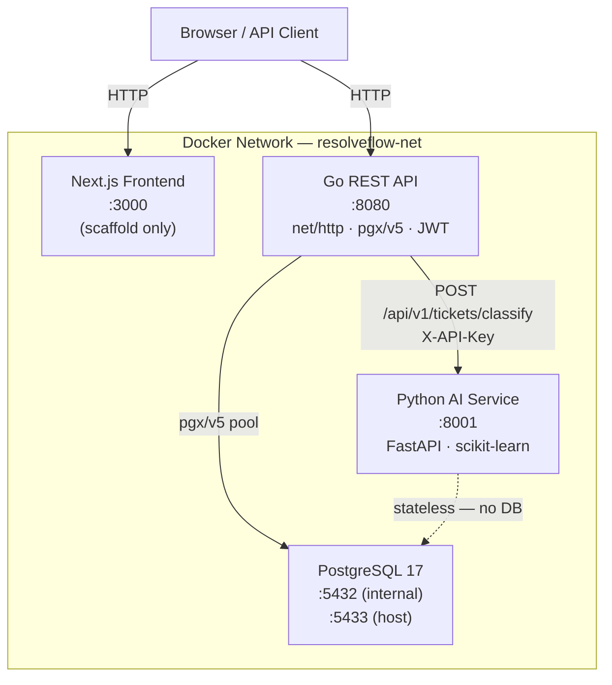

# ResolveFlow AI

An AI-powered customer support ticket management system that automatically classifies incoming tickets by category, priority, and sentiment using a trained machine learning pipeline.

[](https://go.dev/)
[](https://www.python.org/)
[](https://fastapi.tiangolo.com/)
[](https://nextjs.org/)
[](https://www.postgresql.org/)
[](https://scikit-learn.org/)
[](https://docs.docker.com/compose/)

---

## The Problem

Support teams receive high volumes of tickets with no consistent categorisation, making it difficult to route, prioritise, and respond efficiently. Agents spend time manually triaging tickets that could be classified automatically.

ResolveFlow AI addresses this by classifying every new ticket the moment it is created — predicting its category, priority level, and customer sentiment — so agents can focus on resolution rather than triage.

---

## Key Features

### Implemented

**Authentication and authorisation**
- JWT-based authentication (HS256, configurable expiry)
- Role-based access control: `admin`, `manager`, `agent`
- Admin bootstrap on first startup via environment variables
- Registration restricted to development mode; production accounts provisioned by admins

**Ticket management**
- Create, retrieve, update, and soft-delete tickets
- Ticket fields: subject, description, customer name/email, status, priority, channel, category
- Status lifecycle: `open` → `in_progress` → `waiting_for_customer` → `resolved` → `closed`
- Pagination and filtering by status and priority on list endpoints
- Immutable audit history for every field change
- Team assignment and unassignment (admin only)

**Comments**
- Internal and external comments on tickets
- Author type tracking (`agent`, `customer`, `system`)

**Team management**
- Create, update, and list support teams
- Add and remove team members with `lead` or `member` roles

**AI classification**
- Automatic classification on ticket creation (non-blocking — ticket is saved even if the AI service is unavailable)
- Predicts: category, priority, sentiment, and a confidence score
- Classification result stored and retrievable via a dedicated endpoint
- Go backend validates AI responses before persisting them

**Infrastructure**
- Per-IP token-bucket rate limiting (login: 5 req/min, register: 3 req/min, API: 100 req/min)
- Request ID propagation across all log lines
- Structured JSON logging
- Graceful shutdown with configurable timeouts
- Docker Compose orchestration with health checks and dependency ordering

### Frontend

The Next.js frontend scaffold is initialised (Next.js 16, React 19, TypeScript, Tailwind CSS) but the UI is not yet implemented. The backend API is fully functional and can be consumed directly.

### Planned / Not Yet Implemented

- Frontend UI (dashboard, ticket views, AI prediction display)
- Real-time notifications
- Email integration
- SLA tracking and escalation rules
- Response suggestions from the AI service
- Horizontal scaling / Redis-backed rate limiting

---

## Screenshots

The frontend UI is not yet implemented. The following screenshots are suggested once the UI is built:

| # | Suggested screenshot |
|---|---|
| 1 | Login page |
| 2 | Ticket list with status and priority filters |
| 3 | Ticket detail view with AI classification panel |
| 4 | AI prediction result (category, priority, sentiment, confidence) |
| 5 | Team management page |
| 6 | Audit history timeline for a ticket |

---

## System Architecture



### Service responsibilities

| Service | Technology | Responsibility |
|---|---|---|
| Go REST API | Go 1.26, `net/http`, `pgx/v5` | Auth, ticket CRUD, teams, comments, audit history, AI client |
| Python AI service | Python 3.13, FastAPI, scikit-learn | TF-IDF + Logistic Regression classification |
| PostgreSQL | PostgreSQL 17 | Persistent storage, schema managed by golang-migrate |
| Next.js frontend | Next.js 16, React 19, TypeScript, Tailwind CSS | UI scaffold (not yet implemented) |

### Ticket creation flow

```
Client  →  POST /api/v1/tickets
              │
              ├─ JWT middleware validates token
              ├─ INSERT INTO tickets  →  returns ticket row immediately
              ├─ POST http://ai-service:8001/api/v1/tickets/classify  (5 s timeout)
              │     ├─ success  →  INSERT INTO ai_predictions
              │     └─ failure  →  log warning, continue (ticket already saved)
              └─ 201 Created  →  ticket JSON returned to client
```

AI classification is non-blocking. A classifier failure never prevents ticket creation.

---

## AI and Machine Learning

### Pipeline overview

The classifier is a TF-IDF + Logistic Regression pipeline trained on a synthetic dataset of customer support tickets. Three independent models are trained — one each for category, priority, and sentiment — sharing a single TF-IDF vectorizer.

**Model version:** `tfidf-logreg-v1`

### Training configuration

| Component | Setting |
|---|---|
| Vectorizer | TF-IDF, max 10,000 features (5,319 actual), unigrams + bigrams, sublinear TF, English stop words |
| Category model | Logistic Regression, C=10 |
| Priority model | Logistic Regression, C=10, class_weight=balanced |
| Sentiment model | Logistic Regression, C=5 |

### Test set metrics (242 records)

| Model | Accuracy | Macro F1 | Mean confidence |
|---|---|---|---|
| Category | 80.99% | 80.79% | 74.57% |
| Priority | 76.45% | 77.77% | 65.45% |
| Sentiment | 74.79% | 73.15% | 71.27% |

Metrics are taken directly from `ai-service/models/model_metadata.json`.

### Confidence score

The aggregate confidence score returned by the classifier is the **minimum** of the three individual model probabilities (i.e. the most conservative estimate). These are raw `predict_proba` outputs from scikit-learn and are **not calibrated probabilities** — they reflect model certainty relative to the training distribution, not true posterior probabilities.

### Model artifacts

Stored in `ai-service/models/` and loaded once at service startup:

| File | Contents |
|---|---|
| `tfidf_vectorizer.joblib` | Fitted TF-IDF vectorizer |
| `category_model.joblib` | Logistic Regression for category |
| `priority_model.joblib` | Logistic Regression for priority |
| `sentiment_model.joblib` | Logistic Regression for sentiment |
| `model_metadata.json` | Training config, dataset split sizes, test metrics |

---

## Dataset

| Property | Value |
|---|---|
| File | `ai-service/data/tickets_synthetic.csv` |
| Total records | 1,597 |
| Scenario groups | See `ticket_scenario_groups.csv` |
| Training split | 1,119 records |
| Validation split | 236 records |
| Test split | 242 records |

### Labels

| Dimension | Classes |
|---|---|
| Category | `billing`, `technical_support`, `account`, `general_inquiry` |
| Priority | `low`, `medium`, `high`, `urgent` |
| Sentiment | `positive`, `neutral`, `negative` |

### Dataset columns

`ticket_id`, `subject`, `description`, `category`, `priority`, `sentiment`

The `scenario_id` column is stored separately in `ticket_scenario_groups.csv` and is never used as a model feature. It is used only for grouped train/validation/test splitting to prevent near-duplicate leakage across splits.

### Generation and validation scripts

All scripts live in `ai-service/data/`:

| Script | Purpose |
|---|---|
| `_tickets.py`, `_tickets_tech.py`, `_tickets_account.py`, `_tickets_general.py` | Ticket source data by category |
| `_build_dataset.py` | Assembles `tickets_synthetic.csv` from the four source files |
| `_expand_dataset.py` | Expands the dataset with surface-form variants |
| `validate_dataset.py` | 17-section validation report: label validity, duplicates, near-duplicate detection, leakage checks, scenario integrity |
| `correct_dataset.py` | Idempotent correction script (reproducibility) |
| `_audit_925.py` | Stage 9.2.5 independent read-only audit |

### Duplicate label audit (Stage 9.2.5)

A full audit confirmed 146 exact duplicate content groups (389 records, 24.4% of dataset). All 146 groups are fully label-consistent with zero conflicting labels, and all duplicates are contained within a single scenario group — meaning grouped splitting eliminates any leakage risk. See `ai-service/data/reports/stage_9_2_5_duplicate_label_audit.md`.

---

## Technology Stack

### Backend
- Go 1.26 — `net/http` with Go 1.22 pattern routing
- `pgx/v5` — PostgreSQL driver and connection pool
- `golang-jwt/jwt` v5 — HS256 JWT authentication
- `golang.org/x/crypto` — bcrypt password hashing
- `google/uuid` — UUID generation
- `joho/godotenv` — `.env` loading in development
- golang-migrate — SQL migration management

### AI / ML
- Python 3.13
- FastAPI 0.165 + uvicorn
- scikit-learn 1.6.1 — TF-IDF vectorizer, Logistic Regression
- joblib — model serialisation

### Frontend
- Next.js 16, React 19, TypeScript
- Tailwind CSS 4

### Database
- PostgreSQL 17

### Infrastructure
- Docker + Docker Compose v2
- Multi-stage Docker builds (Go: ~31 MB final image; Python: ~247 MB)
- Both containers run as non-root user `appuser`

---

## Project Structure

```
ResolveFlow-AI/
├── backend/
│   ├── cmd/
│   │   └── api/                  Application entry point (main.go)
│   ├── internal/
│   │   ├── auth/                 JWT service, password hashing, validation
│   │   ├── config/               Environment variable loading
│   │   ├── database/             PostgreSQL connection pool
│   │   ├── handlers/             HTTP request handlers (tickets, teams, auth, comments, AI)
│   │   ├── logger/               Structured slog logger
│   │   ├── middleware/           Auth, rate limiting, request ID, logging, recovery
│   │   ├── models/               Domain types (Ticket, User, Team, AIPrediction, …)
│   │   ├── repository/           Database access layer
│   │   ├── routes/               Route registration
│   │   ├── services/             AI HTTP client
│   │   ├── tickets/              Ticket and comment validation
│   │   └── users/                User repository
│   ├── migrations/               SQL migration files (up + down)
│   ├── Dockerfile
│   ├── Makefile
│   ├── go.mod
│   └── go.sum
├── ai-service/
│   ├── app/
│   │   ├── api/                  Route handlers (classify endpoint)
│   │   ├── dependencies/         X-API-Key authentication
│   │   ├── schemas/              Pydantic request/response models
│   │   └── services/             TF-IDF + Logistic Regression classifier
│   ├── data/
│   │   ├── reports/              Audit reports
│   │   ├── _build_dataset.py     Dataset assembly script
│   │   ├── _expand_dataset.py    Dataset expansion script
│   │   ├── validate_dataset.py   17-section dataset validator
│   │   ├── tickets_synthetic.csv Primary training dataset (1,597 records)
│   │   └── ticket_scenario_groups.csv  Scenario group mappings
│   ├── models/                   Trained model artifacts (.joblib) + metadata
│   ├── tests/                    Python unit tests
│   ├── Dockerfile
│   └── requirements.txt
├── frontend/
│   ├── src/
│   │   ├── app/                  Next.js App Router (scaffold)
│   │   ├── components/           UI component directories (scaffold)
│   │   ├── hooks/                Custom React hooks (scaffold)
│   │   ├── services/             API service layer (scaffold)
│   │   └── types/                TypeScript types (scaffold)
│   ├── package.json
│   └── next.config.ts
├── docs/
│   ├── api-documentation.md      Full API reference
│   ├── architecture.md           Architecture and security notes
│   ├── database-design.md        Schema reference
│   └── requirements.md
├── docker-compose.yml
├── .env.example
└── README.md
```

---

## Getting Started

### Prerequisites

- [Docker Desktop 24+](https://www.docker.com/products/docker-desktop/) with Compose v2
- [golang-migrate CLI](https://github.com/golang-migrate/migrate) (for running database migrations)
- Go 1.26+ (local development only)
- Python 3.13+ (local development only)

### 1. Clone the repository

```bash
git clone https://github.com/ChamiNarasinghe/ResolveFlow-AI.git
cd ResolveFlow-AI
```

### 2. Configure environment variables

```bash
# Windows PowerShell
Copy-Item .env.example .env

# macOS / Linux
cp .env.example .env
```

Open `.env` and set the required values (see [Environment Variables](#environment-variables) below).

### 3. Build and start all services

```bash
docker compose up -d
```

### 4. Run database migrations

Migrations are not run automatically. Run them once after the first startup:

```bash
docker compose run --rm backend `
  migrate -path migrations -database "$env:DATABASE_URL" up
```

On macOS/Linux:

```bash
docker compose run --rm backend \
  migrate -path migrations -database "$DATABASE_URL" up
```

### 5. Verify service health

```bash
docker compose ps

# Check individual health endpoints
curl http://localhost:8080/health
curl http://localhost:8080/health/ready
curl http://localhost:8080/health/ai
curl http://localhost:8001/health
```

### 6. Access the services

| Service | URL |
|---|---|
| Go REST API | http://localhost:8080 |
| Python AI service | http://localhost:8001 |
| AI service docs (dev only) | http://localhost:8001/docs |

---

## Environment Variables

Copy `.env.example` to `.env` and fill in the required values. Never commit `.env` to version control.

| Variable | Required | Description |
|---|---|---|
| `POSTGRES_PASSWORD` | Yes | PostgreSQL superuser password |
| `POSTGRES_DB` | No | Database name (default: `resolveflow_db`) |
| `POSTGRES_USER` | No | Database user (default: `resolveflow_user`) |
| `JWT_SECRET` | Yes | HS256 signing key — minimum 32 characters |
| `JWT_EXPIRATION_MINUTES` | No | Token lifetime in minutes (default: `15`) |
| `AI_SERVICE_API_KEY` | No | Shared secret for backend → AI service auth. Leave empty to disable enforcement in development. Required when `APP_ENV=production`. |
| `APP_ENV` | No | `development` or `production` (default: `development`). Controls registration endpoint availability and AI service docs. |
| `PORT` | No | Go backend port (default: `8080`) |
| `LOG_LEVEL` | No | Log level: `debug`, `info`, `warn`, `error` (default: `info`) |
| `DATABASE_URL` | No | Constructed automatically by Docker Compose. Set explicitly only when running the backend outside Docker. |
| `AI_SERVICE_URL` | No | Constructed automatically by Docker Compose. Set explicitly only when running the AI service outside Docker. |
| `BOOTSTRAP_ADMIN_NAME` | No | Full name for the initial admin account (one-time, all three must be set together) |
| `BOOTSTRAP_ADMIN_EMAIL` | No | Email for the initial admin account |
| `BOOTSTRAP_ADMIN_PASSWORD` | No | Password for the initial admin account |

Generate secure secrets:

```bash
openssl rand -base64 32
```

---

## API Documentation

Full documentation with request/response examples is in [`docs/api-documentation.md`](docs/api-documentation.md).

### Authentication

All protected endpoints require:

```
Authorization: Bearer <access_token>
```

### Rate limits

| Scope | Limit |
|---|---|
| `POST /api/v1/auth/login` | 5 req/min per IP |
| `POST /api/v1/auth/register` | 3 req/min per IP |
| All other API routes | 100 req/min per IP |

### Health

| Method | Path | Auth | Description |
|---|---|---|---|
| GET | `/health` | None | Liveness check |
| GET | `/health/ready` | None | Readiness — verifies database connectivity |
| GET | `/health/ai` | None | AI service reachability check |

### Authentication endpoints

| Method | Path | Auth | Description |
|---|---|---|---|
| POST | `/api/v1/auth/register` | None | Register a new agent (development only) |
| POST | `/api/v1/auth/login` | None | Obtain a JWT access token |
| GET | `/api/v1/auth/me` | JWT | Return the authenticated user's profile |

### Ticket endpoints

| Method | Path | Auth | Description |
|---|---|---|---|
| POST | `/api/v1/tickets` | JWT | Create a ticket (triggers AI classification) |
| GET | `/api/v1/tickets` | JWT | List tickets with pagination and filters |
| GET | `/api/v1/tickets/{id}` | JWT | Get a single ticket |
| PATCH | `/api/v1/tickets/{id}` | JWT | Update status, priority, category, assignment |
| DELETE | `/api/v1/tickets/{id}` | Admin | Soft-delete a ticket |
| PATCH | `/api/v1/tickets/{id}/assignment` | Admin | Assign or unassign a team |
| GET | `/api/v1/tickets/{id}/history` | JWT | Paginated audit history |
| GET | `/api/v1/tickets/{id}/ai-prediction` | JWT | Latest AI classification result |
| POST | `/api/v1/tickets/{id}/comments` | JWT | Add a comment |
| GET | `/api/v1/tickets/{id}/comments` | JWT | List comments |

### Team endpoints

| Method | Path | Auth | Description |
|---|---|---|---|
| POST | `/api/v1/teams` | Admin | Create a team |
| GET | `/api/v1/teams` | JWT | List all teams |
| GET | `/api/v1/teams/{id}` | JWT | Get a team |
| PATCH | `/api/v1/teams/{id}` | Admin | Update a team |
| POST | `/api/v1/teams/{id}/members` | Admin | Add a member |
| GET | `/api/v1/teams/{id}/members` | JWT | List members |
| DELETE | `/api/v1/teams/{id}/members/{userId}` | Admin | Remove a member |

### Admin endpoints

| Method | Path | Auth | Description |
|---|---|---|---|
| POST | `/api/v1/admin/users` | Admin | Provision a user with an explicit role |

### Example: create a ticket

```bash
curl -X POST http://localhost:8080/api/v1/tickets \
  -H "Authorization: Bearer <access_token>" \
  -H "Content-Type: application/json" \
  -d '{
    "subject": "Payment failed on checkout",
    "description": "I was charged twice for my subscription renewal.",
    "customer_name": "Jane Smith",
    "customer_email": "jane@example.com",
    "channel": "web"
  }'
```

### Example: retrieve AI prediction

```bash
curl http://localhost:8080/api/v1/tickets/<ticket-id>/ai-prediction \
  -H "Authorization: Bearer <access_token>"
```

```json
{
  "id": "uuid",
  "ticket_id": "uuid",
  "model_version": "tfidf-logreg-v1",
  "category": "billing",
  "predicted_priority": "medium",
  "sentiment": "neutral",
  "confidence": 0.7812,
  "suggested_team_id": null,
  "response_suggestion": null,
  "created_at": "2024-01-01T12:00:00Z"
}
```

---

## Testing

### Go backend

The backend has unit tests across auth, config, database, handlers, middleware, repository, and validation packages.

```bash
cd backend

# Run all tests
go test ./...

# Run with coverage report
go test -coverprofile=coverage.out ./...
go tool cover -html=coverage.out

# Static analysis
go vet ./...
```

### Python AI service

```bash
cd ai-service

pip install -r requirements.txt

# Run all tests
python -m pytest tests/ -v

# Run a specific test file
python -m pytest tests/test_ticket_classifier.py -v
python -m pytest tests/test_api_key_auth.py -v
python -m pytest tests/test_health_ready.py -v
```

Test coverage includes:
- Classifier predictions (category, priority, sentiment, confidence range)
- API key authentication (correct key, wrong key, missing header, empty key)
- Production startup guard (refuses to start without `AI_SERVICE_API_KEY` when `APP_ENV=production`)
- Docs endpoint availability (disabled in production, enabled in development)
- Readiness probe behaviour (200 when classifier is healthy, 503 when it fails)

---

## Model Training and Evaluation

The trained model artifacts are committed to the repository in `ai-service/models/`. To reproduce the training pipeline:

### 1. Rebuild the dataset (optional)

```bash
cd ai-service/data
python _build_dataset.py
```

### 2. Validate the dataset

```bash
cd ai-service/data
python validate_dataset.py tickets_synthetic.csv --groups ticket_scenario_groups.csv
```

### 3. Train the models

The training script is not committed to the repository. The artifacts in `ai-service/models/` were produced by a grouped train/validation/test split (70/15/15) that respects scenario boundaries to prevent near-duplicate leakage. To retrain, implement a script that:

1. Loads `tickets_synthetic.csv`
2. Applies a grouped split using `ticket_scenario_groups.csv`
3. Fits a `TfidfVectorizer` on the training set (see `model_metadata.json` for parameters)
4. Trains three `LogisticRegression` models (category, priority, sentiment)
5. Saves artifacts with `joblib.dump` to `ai-service/models/`
6. Updates `model_metadata.json` with the new metrics

---

## Local Development (without Docker)

### Go backend

```bash
cd backend

# Requires a running PostgreSQL instance and DATABASE_URL set in .env
go run ./cmd/api
```

### Python AI service

```bash
cd ai-service

pip install -r requirements.txt
uvicorn app.main:app --reload --port 8001
```

### Database migrations

```bash
cd backend

make migrate-up        # apply all pending migrations
make migrate-down      # roll back one migration
make migrate-version   # print current schema version
make migrate-create NAME=add_something  # scaffold a new migration pair
```

---

## Docker Operations

```bash
# View logs
docker compose logs -f backend
docker compose logs -f ai-service

# Rebuild after code changes
docker compose build backend
docker compose up -d backend

# Stop all services (data preserved)
docker compose down

# Stop and remove all volumes — DESTRUCTIVE, deletes all data
docker compose down -v
```

---

## Future Improvements

- Implement the Next.js frontend (dashboard, ticket views, AI prediction panel)
- Add response suggestions to the AI classifier output
- Calibrate model probabilities (Platt scaling or isotonic regression) for more meaningful confidence scores
- Add a model retraining pipeline with versioned artifact storage
- Implement real-time ticket notifications (WebSocket or SSE)
- Add email channel integration
- SLA tracking and automatic escalation rules
- Redis-backed rate limiting for horizontally scaled deployments
- OpenTelemetry tracing across Go and Python services
- End-to-end integration tests

---

## Author

**Chami Narasinghe**

- GitHub: [github.com/ChamiNarasinghe](https://github.com/ChamiNarasinghe)
- LinkedIn: [linkedin.com/in/chami-narasinghe-b01737281](https://www.linkedin.com/in/chami-narasinghe-b01737281/)
